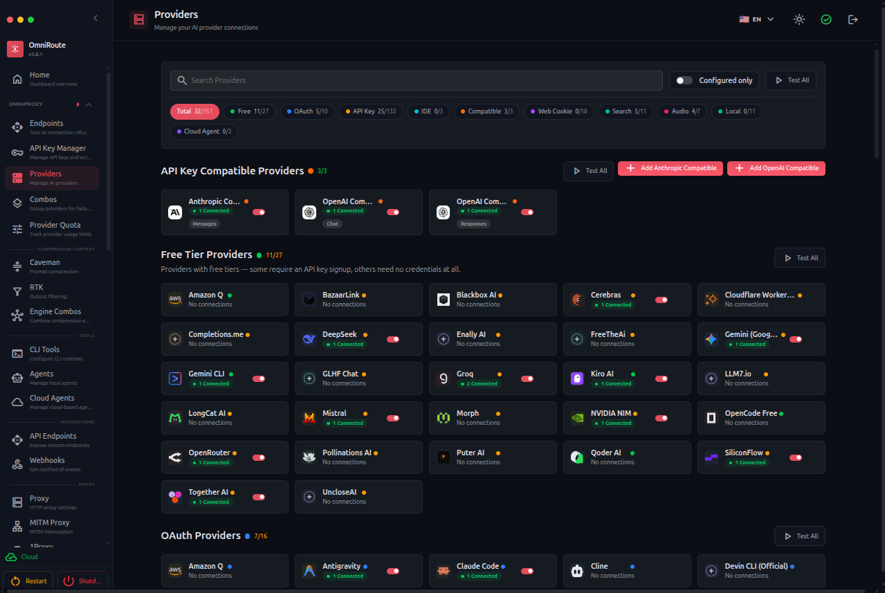
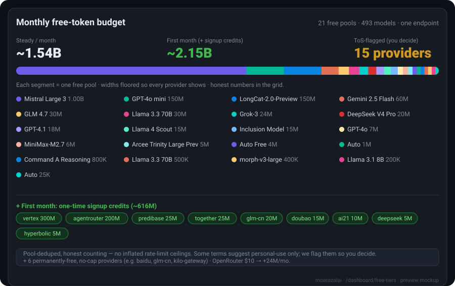

<div align="center">



<br/>

# 🚀 moatazalai — The Free AI Gateway

## العربية

### نظرة عامة
`moatazalai` هو موجه ذكاء اصطناعي موحد يربطك بأكثر من 160 مزود خدمة للذكاء الاصطناعي. يتميز بتقنيات ضغط متقدمة مثل RTK+Caveman، وآلية احتياطية تلقائية (auto fallback)، ودعم لبروتوكولات MCP/A2A. يوفر المشروع تطبيقات سطح مكتب (desktop) وتطبيقات ويب تقدمية (PWA)، بالإضافة إلى واجهات برمجة تطبيقات (APIs) متوافقة مع OpenAI، مما يجعله حلاً شاملاً لإدارة وتوجيه طلبات الذكاء الاصطناعي بكفاءة ومرونة.

### الميزات الرئيسية
*   **دعم واسع للمزودين:** يتصل بأكثر من 160 مزود خدمة للذكاء الاصطناعي، مما يمنحك خيارات متعددة ومرونة في الاختيار.
*   **ضغط RTK+Caveman:** تقنيات ضغط متقدمة لتحسين الأداء وتقليل استهلاك الموارد.
*   **الاحتياطي التلقائي (Auto Fallback)::** يضمن استمرارية الخدمة عن طريق التبديل التلقائي إلى مزود بديل في حال فشل المزود الأساسي.
*   **دعم MCP/A2A:** يدعم بروتوكولات Model Context Protocol (MCP) و Agent-to-Agent (A2A) لتكامل سلس.
*   **تطبيقات سطح المكتب و PWA:** يوفر تجربة مستخدم مرنة عبر تطبيقات سطح المكتب وتطبيقات الويب التقدمية.
*   **واجهات برمجة تطبيقات متوافقة مع OpenAI:** يتيح لك استخدام أدوات ومكتبات OpenAI الحالية مع `moatazalai`.

### البدء السريع
للبدء باستخدام `moatazalai`، اتبع الخطوات التالية:

1.  **استنساخ المستودع:**
    ```bash
    git clone https://github.com/stydentali-pixel/moatazalai.git
    cd moatazalai
    ```

2.  **تثبيت التبعيات:**
    ```bash
    npm install
    ```

3.  **تشغيل المشروع:**
    ```bash
    npm run dev
    ```
    سيتم تشغيل المشروع على `http://localhost:20128` بشكل افتراضي.

### المساهمة
نرحب بالمساهمات! إذا كنت ترغب في المساهمة في تطوير `moatazalai`، يرجى قراءة إرشادات المساهمة (إذا كانت متوفرة في المشروع الأصلي) أو فتح طلب سحب (Pull Request) مع وصف واضح للتغييرات المقترحة.

### الترخيص
هذا المشروع مرخص بموجب ترخيص MIT. انظر ملف [LICENSE](LICENSE) لمزيد من التفاصيل.

## English

### Overview
`moatazalai` is a unified AI router that connects you to over 160 AI service providers. It features advanced compression technologies like RTK+Caveman, automatic fallback mechanisms, and support for MCP/A2A protocols. The project offers desktop applications and Progressive Web Apps (PWAs), along with OpenAI-compatible APIs, making it a comprehensive solution for efficiently and flexibly managing and routing AI requests.

### Key Features
*   **Extensive Provider Support:** Connects to over 160 AI service providers, giving you multiple options and flexibility.
*   **RTK+Caveman Compression:** Advanced compression techniques to improve performance and reduce resource consumption.
*   **Auto Fallback:** Ensures service continuity by automatically switching to an alternative provider if the primary one fails.
*   **MCP/A2A Support:** Supports Model Context Protocol (MCP) and Agent-to-Agent (A2A) protocols for seamless integration.
*   **Desktop and PWA Applications:** Provides a flexible user experience through desktop applications and Progressive Web Apps.
*   **OpenAI-Compatible APIs:** Allows you to use existing OpenAI tools and libraries with `moatazalai`.

### Quick Start
To get started with `moatazalai`, follow these steps:

1.  **Clone the repository:**
    ```bash
    git clone https://github.com/stydentali-pixel/moatazalai.git
    cd moatazalai
    ```

2.  **Install dependencies:**
    ```bash
    npm install
    ```

3.  **Run the project:**
    ```bash
    npm run dev
    ```
    The project will run on `http://localhost:20128` by default.

### Contributing
Contributions are welcome! If you'd like to contribute to `moatazalai`, please read the contribution guidelines (if available in the original project) or open a Pull Request with a clear description of your proposed changes.

### License
This project is licensed under the MIT License. See the [LICENSE](LICENSE) file for more details.

### Never stop coding. Connect every AI tool to **237 providers** — **90+ free** — through one endpoint.

**Plug Claude Code, Codex, Cursor, Cline, Copilot & Antigravity into FREE Claude / GPT / Gemini. Auto-fallback.**
<br/>

**RTK + Caveman compression saves 15–95% tokens. Never hit limits.**

<br/>

**~1.6B documented free tokens/month** — up to **~2.1B in your first month** with signup credits — aggregated across the free tiers, plus a long tail of permanently-free, no-cap providers, and the compression above stretches every one further. ([how we count →](docs/reference/FREE_TIERS.md#tldr--how-much-free-inference-does-moatazalai-actually-aggregate))

<br/>

<h3>

⭐ Star the repo if MOATAZALAI helped you save money and make your work easier. [](https://github.com/moatazalai/moatazalai)
</h3>

<a href="https://trendshift.io/repositories/23589" target="_blank"></a>

[](#-237-ai-providers--90-free)
[](#-237-ai-providers--90-free)
[](docs/reference/FREE_TIERS.md)
[](#%EF%B8%8F-save-1595-tokens--automatically)
[](#-combos--the-flagship)
[](#-quick-start)

<br/>

### 💬 Join the community

[](https://discord.gg/EkzRkpzKYt)
[](https://t.me/moatazalaiOficial)
[](https://chat.whatsapp.com/JI7cDQ1GyaiDHhVBpLxf8b?mode=gi_t)
[](https://chat.whatsapp.com/BTGJXIyjeNIIgExvTMGGhI)
[](https://moatazalai.online)

**Questions, provider tips, roadmap & support → [Discord](https://discord.gg/EkzRkpzKYt) · [Telegram](https://t.me/moatazalaiOficial) · WhatsApp [🌍 Global](https://chat.whatsapp.com/JI7cDQ1GyaiDHhVBpLxf8b?mode=gi_t) / [🇧🇷 Brasil](https://chat.whatsapp.com/BTGJXIyjeNIIgExvTMGGhI)**

<br/>

### 🧩 Available

[](https://www.npmjs.com/package/moatazalai)

[](https://hub.docker.com/r/moatazalai/moatazalai)
[](LICENSE)


[**🚀 Quick Start**](#-quick-start) • [**🎯 Combos**](#-combos--the-flagship) • [**🌐 Providers**](#-237-ai-providers--90-free) • [**🔌 CLI & MCP**](#-full-cli--a2a--mcp) • [**🗜️ Compression**](#%EF%B8%8F-save-1595-tokens--automatically) • [**🌍 Website**](https://moatazalai.online)

[💥 The Promise](#-the-promise) • [🤔 Why](#-why-moatazalai) • [🏆 What Sets Apart](#-what-sets-moatazalai-apart) • [🤖 Compatible CLIs](#-compatible-clis--coding-agents) • [🖥️ Where It Runs](#%EF%B8%8F-where-moatazalai-runs--anywhere) • [🔒 Private](#-private--local-first) • [🎬 In Action](#-moatazalai-in-action) • [📚 Explore More](#-explore-more) • [📧 Support](#-support--community)

</div>

<div align="center">
 <b>🌐 In 42+ languages</b>
 <table>
  <tr>
    <td align="center"><a href="README.md">🇺🇸</a></td>
    <td align="center"><a href="docs/i18n/pt-BR/README.md">🇧🇷</a></td>
    <td align="center"><a href="docs/i18n/pt/README.md">🇵🇹</a></td>
    <td align="center"><a href="docs/i18n/es/README.md">🇪🇸</a></td>
    <td align="center"><a href="docs/i18n/fr/README.md">🇫🇷</a></td>
    <td align="center"><a href="docs/i18n/it/README.md">🇮🇹</a></td>
    <td align="center"><a href="docs/i18n/de/README.md">🇩🇪</a></td>
    <td align="center"><a href="docs/i18n/nl/README.md">🇳🇱</a></td>
    <td align="center"><a href="docs/i18n/ru/README.md">🇷🇺</a></td>
    <td align="center"><a href="docs/i18n/uk-UA/README.md">🇺🇦</a></td>
    <td align="center"><a href="docs/i18n/pl/README.md">🇵🇱</a></td>
    <td align="center"><a href="docs/i18n/cs/README.md">🇨🇿</a></td>
    <td align="center"><a href="docs/i18n/sk/README.md">🇸🇰</a></td>
    <td align="center"><a href="docs/i18n/ro/README.md">🇷🇴</a></td>
    <td align="center"><a href="docs/i18n/hu/README.md">🇭🇺</a></td>
  </tr>
  <tr>
    <td align="center"><a href="docs/i18n/bg/README.md">🇧🇬</a></td>
    <td align="center"><a href="docs/i18n/da/README.md">🇩🇰</a></td>
    <td align="center"><a href="docs/i18n/fi/README.md">🇫🇮</a></td>
    <td align="center"><a href="docs/i18n/no/README.md">🇳🇴</a></td>
    <td align="center"><a href="docs/i18n/sv/README.md">🇸🇪</a></td>
    <td align="center"><a href="docs/i18n/zh-CN/README.md">🇨🇳</a></td>
    <td align="center"><a href="docs/i18n/zh-TW/README.md">🇹🇼</a></td>
    <td align="center"><a href="docs/i18n/ja/README.md">🇯🇵</a></td>
    <td align="center"><a href="docs/i18n/ko/README.md">🇰🇷</a></td>
    <td align="center"><a href="docs/i18n/th/README.md">🇹🇭</a></td>
    <td align="center"><a href="docs/i18n/vi/README.md">🇻🇳</a></td>
    <td align="center"><a href="docs/i18n/id/README.md">🇮🇩</a></td>
    <td align="center"><a href="docs/i18n/ms/README.md">🇲🇾</a></td>
    <td align="center"><a href="docs/i18n/phi/README.md">🇵🇭</a></td>
  </tr>
  <tr>
    <td align="center"><a href="docs/i18n/in/README.md">🇮🇳</a></td>
    <td align="center"><a href="docs/i18n/hi/README.md">🇮🇳</a></td>
    <td align="center"><a href="docs/i18n/gu/README.md">🇮🇳</a></td>
    <td align="center"><a href="docs/i18n/mr/README.md">🇮🇳</a></td>
    <td align="center"><a href="docs/i18n/ta/README.md">🇮🇳</a></td>
    <td align="center"><a href="docs/i18n/te/README.md">🇮🇳</a></td>
    <td align="center"><a href="docs/i18n/bn/README.md">🇧🇩</a></td>
    <td align="center"><a href="docs/i18n/ur/README.md">🇵🇰</a></td>
    <td align="center"><a href="docs/i18n/fa/README.md">🇮🇷</a></td>
    <td align="center"><a href="docs/i18n/ar/README.md">🇸🇦</a></td>
    <td align="center"><a href="docs/i18n/he/README.md">🇮🇱</a></td>
    <td align="center"><a href="docs/i18n/tr/README.md">🇹🇷</a></td>
    <td align="center"><a href="docs/i18n/az/README.md">🇦🇿</a></td>
    <td align="center"><a href="docs/i18n/sw/README.md">🇹🇿</a></td>
  </tr>
</table>
</div>

<br/>

<div align="center">

# 💰 ~1.6B Free Tokens / Month

</div>

> Stacking free tiers by hand is painful — dozens of SDKs, dozens of rate limits, and no idea how much you actually have. moatazalai aggregates the **documented** free tiers of **40+ provider pools / 500+ models** into one honest number and shows it live on the dashboard (`/dashboard/free-tiers`).

- **~1.6B free tokens / month** (steady) — and **up to ~2.1B in your first month** with signup credits.
- **Pool-deduped, honest** — we count each shared free pool **once**, so the headline isn't inflated by rate-limit ceilings the way multi-billion competitor claims are. (Counting every rate limit 24/7 would read ~10B; we don't publish that.)
- **Plus the un-countable** — permanently-free, no-token-cap providers (SiliconFlow, Z.AI GLM-Flash, Kilo, OpenCode Zen…) and a **$10 OpenRouter top-up** that unlocks **+24M/mo**, both surfaced separately so they never inflate the headline.
- **Per-model breakdown**, **live used / remaining** for the current month, and a transparent **terms flag** per provider.



> Preview mockup — a real screenshot lands once the `/dashboard/free-tiers` page is validated. Full methodology (pool dedupe, credit tiers, provider terms): **[docs/reference/FREE_TIERS.md](docs/reference/FREE_TIERS.md)**.

<br/>

<div align="center">

# 💥 The Promise

</div>

> One endpoint. **237 providers.** Never stop building — and let moatazalai pick the cheapest one that works.

<table>
  <tr>
    <td width="33%" valign="top"><b>🚫 Never hit limits</b><br/><sub>Auto-fallback across 237 providers in milliseconds. Quota out? Next provider takes over — zero downtime.</sub></td>
    <td width="33%" valign="top"><b>💸 Save up to 95% tokens</b><br/><sub>RTK + Caveman stacked compression cuts 15–95% of eligible tokens (~89% avg on tool-heavy sessions).</sub></td>
    <td width="33%" valign="top"><b>🆓 $0 to start</b><br/><sub>90+ providers with a free tier, 11 free <i>forever</i> (Kiro, Qoder, Pollinations, LongCat…). No card needed.</sub></td>
  </tr>
  <tr>
    <td width="33%" valign="top"><b>🔌 Every tool works</b><br/><sub>24+ coding agents — Claude Code, Codex, Cursor, Cline, Copilot, Antigravity — through one config.</sub></td>
    <td width="33%" valign="top"><b>🧩 One endpoint</b><br/><sub>OpenAI ↔ Claude ↔ Gemini ↔ Responses API translation. Point any tool at <code>/v1</code> and it just works.</sub></td>
    <td width="33%" valign="top"><b>🛡️ Production-grade</b><br/><sub>Circuit breakers, TLS stealth, MCP (95 tools), A2A, memory, guardrails, evals. 21,000+ tests.</sub></td>
  </tr>
</table>

<br/>
<br/>

<div align="center">

# 🤔 Why moatazalai?

</div>

> Stop juggling 10 dashboards, dead API keys, and surprise bills.

| ❌ The daily pain                                      | ✅ How moatazalai fixes it                                                     |
| ------------------------------------------------------ | ----------------------------------------------------------------------------- |
| 📉 Subscription quota expires unused every month       | **Maximize subscriptions** — track quota, use every token before reset        |
| 🛑 Rate limits stop you mid-coding                     | **4-tier auto-fallback** — Subscription → API → Cheap → Free, in milliseconds |
| 🔥 Tool outputs (`git diff`, `grep`, logs) burn tokens | **RTK + Caveman compression** — save 15–95% eligible tokens per request       |
| 💸 Expensive APIs ($20–50/mo per provider)             | **Cost-optimized routing** — auto-route to the cheapest viable model          |
| 🧰 Each AI tool wants its own setup                    | **One endpoint, every tool, one dashboard**                                   |
| 🌍 AI blocked in your country                          | **3-level proxy** + TLS fingerprint stealth — use AI from anywhere            |

<div align="center">

```
┌──────────────────────────────────────────────────────────┐
│        Your IDE / CLI  (Claude Code, Cursor, Cline…)       │
└─────────────────────────┬──────────────────────────────────┘
                          │ http://localhost:20128/v1
                          ▼
┌──────────────────────────────────────────────────────────┐
│                  moatazalai — Smart Router                  │
│  RTK + Caveman compression · 17 routing strategies         │
│  Circuit breakers · TLS stealth · MCP · A2A · Guardrails   │
│  21,000+ tests · 160+ providers · 90+ free tiers           │
└─────────────────────────┬──────────────────────────────────┘
        ┌─────────────┬────┴────────┬─────────────┐
        ▼ Tier 1      ▼ Tier 2      ▼ Tier 3       ▼ Tier 4
   SUBSCRIPTION     API KEY        CHEAP          FREE
   Claude Code,     DeepSeek,      GLM $0.5,      Kiro, Qoder,
   Codex, Copilot   Groq, xAI      MiniMax $0.2   Pollinations
   quota out? ───▶  budget hit? ─▶ budget hit? ─▶ always on
```

</div>

<br/>

<div align="center">

# 🎯 Combos — The Flagship

</div>

> A **combo** is a chain of models moatazalai routes across **automatically**. Quota runs out, a provider fails, or costs spike — the combo silently slides to the next model. **This is what makes moatazalai unbreakable.** 🛡️

### ⚡ Zero-config — just use `auto`

No combo to create. Set your model to `auto` (or a variant) and moatazalai builds a virtual combo from your connected providers, scored live:

| Model ID       | What it optimizes for                                          |
| -------------- | -------------------------------------------------------------- |
| `auto`         | 🎯 Balanced default (LKGP — sticks to your last good provider) |
| `auto/coding`  | 🧑‍💻 Quality-first weights for code generation                   |
| `auto/fast`    | ⚡ Lowest latency first                                        |
| `auto/cheap`   | 💰 Cheapest per token first                                    |
| `auto/offline` | 🔋 Most quota / rate-limit headroom first                      |
| `auto/smart`   | 🔭 Quality-first + 10% exploration to discover better models   |

##

### 🔀 Or build your own — 17 routing strategies

All **17** strategies — mix & match per combo step:

| #   | Strategy            | What it does                                                     |
| --- | ------------------- | ---------------------------------------------------------------- |
| 1   | `priority`          | First-target ordered list — drain each before the next 🥇        |
| 2   | `fill-first`        | Fill each target's quota fully before moving on                  |
| 3   | `weighted`          | Weighted random by per-target weight                             |
| 4   | `round-robin`       | Cycle through targets in order                                   |
| 5   | `p2c`               | Power-of-two-choices random load balancing                       |
| 6   | `least-used`        | Pick the target with the lowest current load                     |
| 7   | `random`            | Uniform random pick (deduplicated)                               |
| 8   | `strict-random`     | Random without de-duplicating repeats 🎲                         |
| 9   | `cost-optimized`    | Minimize $ per request from live catalog pricing 💸              |
| 10  | `headroom`          | Pick the target with the most remaining quota                    |
| 11  | `reset-window`      | Prefer the target whose quota window resets soonest              |
| 12  | `reset-aware`       | Rank by quota reset time — short windows first 📊                |
| 13  | `sticky`            | Stick to the same target for a session                           |
| 14  | `hash`              | Consistent hashing for target selection                          |
| 15  | `latency-optimized` | Pick the fastest target 🚀                                       |
| 16  | `quality-optimized` | Pick the highest quality target ✨                               |
| 17  | `custom`            | Define your own logic for routing                                |

<br/>

<div align="center">

# 🌐 237 AI Providers — 90+ Free

</div>

> moatazalai aggregates **237 AI providers** — **90+ free** — into one endpoint. No more juggling API keys, rate limits, and different SDKs. Just plug in your credentials and let moatazalai handle the rest.

### 🔌 Connect your providers

Connect your existing API keys or use moatazalai's built-in free tiers. moatazalai supports:

*   **OpenAI**
*   **Anthropic (Claude)**
*   **Google (Gemini)**
*   **Mistral AI**
*   **Perplexity AI**
*   **Cohere**
*   **Hugging Face**
*   **Replicate**
*   **Azure OpenAI**
*   **AWS Bedrock**
*   **And many more...**

[**→ Full list of supported providers**](docs/reference/PROVIDERS.md)

<br/>

<div align="center">

# 🗜️ Save 15–95% Tokens — Automatically

</div>

> moatazalai's **RTK + Caveman compression** automatically reduces token usage by 15–95% on eligible requests. This means lower costs and faster responses, especially for tool-heavy sessions.

### How it works

moatazalai analyzes your prompts and responses, identifying redundant information and applying advanced compression algorithms to reduce token count without sacrificing quality. It's like having a smart assistant optimizing your AI conversations in real-time.

<br/>

<div align="center">

# 🔌 Full CLI & A2A & MCP

</div>

> moatazalai provides a powerful Command Line Interface (CLI) for advanced users, along with support for Agent-to-Agent (A2A) communication and the Model Context Protocol (MCP). This enables seamless integration with your existing workflows and advanced AI agent capabilities.

### CLI Features

*   **Interact with moatazalai:** Manage providers, monitor usage, and configure routing strategies directly from your terminal.
*   **Automate tasks:** Script complex AI workflows and integrate moatazalai into your CI/CD pipelines.

### A2A & MCP

*   **Agent-to-Agent Communication:** Enable your AI agents to communicate and collaborate efficiently.
*   **Model Context Protocol (MCP):** Leverage advanced context management for more intelligent and coherent AI interactions.

<br/>

<div align="center">

# 🖥️ Where moatazalai Runs — Anywhere

</div>

> moatazalai is designed to run everywhere you need it, offering flexibility and accessibility across various platforms.

### Platforms

*   **Desktop Applications:** Dedicated applications for Windows, macOS, and Linux.
*   **Progressive Web Apps (PWA):** Access moatazalai directly from your browser with an installable, app-like experience.
*   **Docker:** Deploy moatazalai easily in containerized environments.
*   **npm:** Integrate moatazalai into your Node.js projects.

<br/>

<div align="center">

# 🔒 Private — Local-First

</div>

> Your data privacy is paramount. moatazalai operates with a local-first approach, ensuring your sensitive information remains under your control.

### Privacy Features

*   **Local Data Processing:** Most operations are performed locally, minimizing data transfer to external servers.
*   **TLS Stealth:** Advanced security measures to protect your connections and data in transit.
*   **No Cloud Lock-in:** You retain full control over your data and configurations.

<br/>

<div align="center">

# 🎬 moatazalai In Action

</div>

> See moatazalai in action with these examples and use cases.

*   **Code Generation:** Use moatazalai with your favorite coding agents (Claude Code, Codex, Cursor, Cline, Copilot, Antigravity) to generate code efficiently.
*   **Content Creation:** Leverage multiple AI providers for creative writing, summarization, and translation.
*   **Data Analysis:** Integrate with AI models for advanced data processing and insights.

<br/>

<div align="center">

# 📚 Explore More

</div>

> Dive deeper into moatazalai's capabilities with our comprehensive documentation.

*   [**Documentation**](docs/README.md)
*   [**API Reference**](docs/api/README.md)
*   [**Provider List**](docs/reference/PROVIDERS.md)
*   [**Free Tiers Methodology**](docs/reference/FREE_TIERS.md)

<br/>

<div align="center">

# 📧 Support & Community

</div>

> Join our vibrant community for support, discussions, and updates.

*   **Discord:** [Join our Discord server](https://discord.gg/EkzRkpzKYt)
*   **Telegram:** [Join our Telegram channel](https://t.me/moatazalaiOficial)
*   **WhatsApp Global:** [Join our global WhatsApp group](https://chat.whatsapp.com/JI7cDQ1GyaiDHhVBpLxf8b?mode=gi_t)
*   **WhatsApp Brasil:** [Join our Brasil WhatsApp group](https://chat.whatsapp.com/BTGJXIyjeNIIgExvTMGGhI)
*   **Website:** [Visit moatazalai.online](https://moatazalai.online)

</div>
